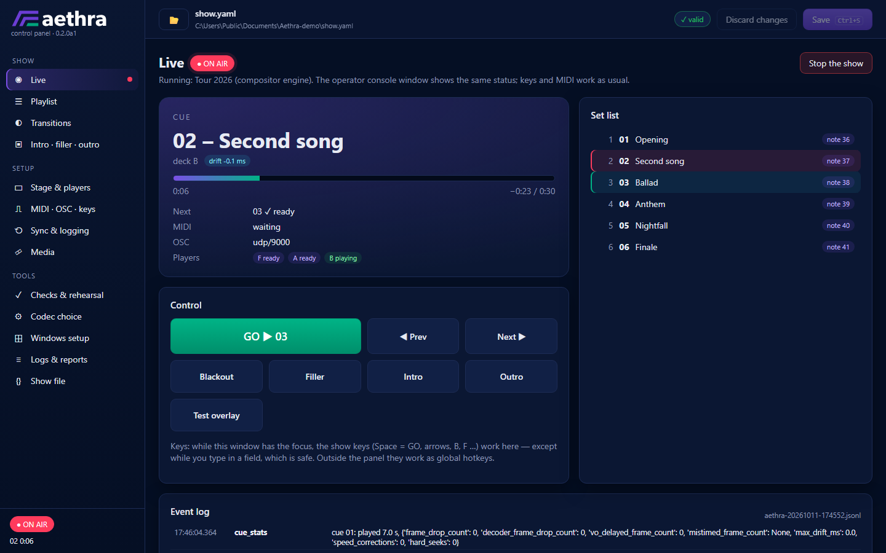

<p align="center">
  <picture>
    <source media="(prefers-color-scheme: dark)" srcset="gfx/aethra-logo-horizontal-on-dark.svg">
    
  </picture>
</p>

# Aethra

**A reliability-first stage video player.** Aethra runs on a dedicated Windows
laptop and plays one pre-rendered clip per song, in sync with a backing track
played by [REAPER](https://www.reaper.fm/) on another computer. Between songs it
shows a filler. Whatever goes wrong, the stage output never shows a dialog, a
frozen picture or the Windows desktop.

```
REAPER ──MIDI note / OSC / MTC──▶ Aethra (Python) ──IPC──▶ compositor: 3 × libmpv + OpenGL ──▶ projector / LED wall
```

- **Instant, synchronous starts.** The next clip waits in a second player,
  paused on its first frame; a MIDI note (or OSC message) from REAPER just
  releases it. A clip that was not preloaded is loaded slightly ahead of time
  and released at the exact moment, so even then the first visible frame is in
  sync.
- **Stays in sync.** While a clip plays, its position is compared with the
  trigger clock (or MIDI Time Code from REAPER) and gently corrected by tiny
  speed changes; a relocation is followed with one exact seek.
- **Transitions**: cut, cross-fade, fade through black or white, or 25 blend
  modes (multiply, screen, overlay, difference, hue, ...), into and out of
  every song, whatever the other picture is. The out-transition starts before
  the clip ends, so the filler has taken over at its last frame. Global
  settings, overridable per song.
- **Intro, filler between songs, outro**: solid colour, still image or video
  loop each. The intro runs until the first song, the outro starts after the
  last one, and both can be called at any time.
- **Fails safe.** A broken file never reaches the stage. A crashed or hung
  player - or the whole compositor - is replaced while the filler (or black)
  covers for it, and the song is rejoined at the right position. A black window
  owned by the controller sits under everything. If the controller itself
  crashes, the launcher restarts it and it takes over the still-running players
  without a visible interruption.
- **Manual control** with global hotkeys: GO, next/previous cue, blackout,
  filler.
- **Event log** with microsecond timestamps and a post-show report.
- **Test mode**: timecode, frame number, dropped frames and drift on screen.
- **Control panel** (`Aethra panel`): edit the show and the playlist, run the
  checks, the codec benchmark and the Windows preparation, start and watch the
  show, read the reports — [docs/control-panel.md](docs/control-panel.md).

  

- One shortcut to start, optional autostart, no internet needed at run time.

Built on [mpv](https://mpv.io/): libmpv players composed on the GPU by a
separate compositor process (OpenGL via [GLFW](https://www.glfw.org/)), hardware
decoding, everything controlled over mpv's JSON IPC. A simpler engine with one
mpv window per player (transitions through black) is the fallback. Runtime
dependencies: Python ≥ 3.11, PyYAML and glfw; the Windows bundle includes them.

> **Status: 0.1, not yet used on stage.** The core is covered by unit tests and
> by integration tests against a real mpv and the compositor on Linux. On a
> Windows 11 desktop with mpv 0.41 the following was verified: named-pipe IPC
> (0.1 ms round trip), playback locked to the system clock, window stacking and
> the black backdrop (screenshots of the stage output), a killed player
> replaced with the song rejoined in sync, a killed controller taking over the
> running players without interrupting the picture, and the compositor on an
> NVIDIA GPU: cross-fades and blend modes (screenshots), out-transitions ending
> with the clip, the set played twice with no dropped frames and no drift, a
> killed compositor back within a second, hardware decoding in every layer.
> Still to verify on the show laptop: its GPU with the compositor, MIDI from a
> real device (WinMM), global hotkeys during a show, display hot-plug and the
> codec choice — see [docs/testing.md](docs/testing.md).

## Getting started on the show laptop

**With the installer** (`Aethra-<version>-setup.exe` from the releases): run it
on the laptop — no administrator rights, no internet needed. It installs into
your user folder (`%USERPROFILE%\Aethra` by default) with the shortcuts
*Aethra* (the show) and *Aethra panel* (the control panel); put the clips into
`media\` and continue with step 3 (or do everything in the panel). Updating
keeps `show.yaml`, `media\` and `logs\`; uninstalling leaves them too.

**Without the installer:**

1. Build the bundle (on any computer with Python and internet access):

   ```bash
   python tools/build_windows_bundle.py --mpv-dir path/to/mpv --libmpv path/to/libmpv-2.dll --zip
   ```

   The release build (bundle and installer, on Linux in a container):
   `docker compose -f docker/build.compose.yaml run --rm build`.

   This creates `dist/Aethra/` (and a zip): embeddable Python, PyYAML, glfw,
   Aethra, mpv with libmpv, the launcher and the docs. Windows mpv builds:
   <https://mpv.io/installation/> (e.g. the shinchiro builds: `mpv-x86_64-*.7z`,
   and `libmpv-2.dll` from `mpv-dev-x86_64-*.7z` of the same date).

2. Copy the folder to the laptop, e.g. `C:\Aethra`, and put the clips into
   `media\`.
3. Edit `show.yaml` (commented example: [examples/show.example.yaml](examples/show.example.yaml),
   reference: [docs/configuration.md](docs/configuration.md)), then run:

   ```bat
   cd C:\Aethra
   .\Aethra.cmd devices
   .\Aethra.cmd check
   .\Aethra.cmd verify
   .\Aethra.cmd selftest --windows
   ```

4. Create the desktop shortcut (and optionally autostart):

   ```bat
   powershell -ExecutionPolicy Bypass -File scripts\install-shortcuts.ps1 -Autostart
   ```

5. Prepare Windows so nothing can pop up on the stage:
   [docs/windows-setup.md](docs/windows-setup.md) and
   `scripts\prepare-stage-laptop.ps1`.
6. Set up REAPER: [docs/reaper-setup.md](docs/reaper-setup.md).
7. Choose the codec by measuring on the laptop: [docs/codec-selection.md](docs/codec-selection.md).
8. Run the tests in [docs/testing.md](docs/testing.md) before the first show.

Running a show: [docs/operation.md](docs/operation.md).

## Commands

| Command | |
|---|---|
| `aethra run [show.yaml] [--test-mode]` | Run the show (`Aethra.cmd` does this and restarts it after a crash). |
| `aethra check [show.yaml]` | Validate the configuration, media files, MIDI port, screens. |
| `aethra verify [show.yaml] [--quick]` | Decode every media file to find damaged ones. |
| `aethra devices` | List MIDI inputs and screens. |
| `aethra monitor [show.yaml]` | Print incoming MIDI notes, MTC and OSC — for setting up REAPER. |
| `aethra bench FILE... [--config show.yaml]` | Codec test: dropped frames and CPU load on this machine. |
| `aethra selftest [show.yaml] [--windows]` | Measures what Aethra relies on, on this machine: IPC latency, mpv playback rate, timer accuracy, hotkeys, window stacking. |
| `aethra rehearse [show.yaml] [--loops 2]` | Plays the whole set through a running show over OSC, without REAPER (soak test). |
| `aethra report [logs]` | Post-show summary of the newest event log. |
| `aethra send ADDRESS [ARGS]` | Send one OSC message (testing). |

On the laptop every command is also available as `.\Aethra.cmd <command> ...` (in cmd and PowerShell).

## Documentation

- [Architecture](docs/architecture.md) — decks, window stacking, timing model, failure handling
- [Configuration reference](docs/configuration.md)
- [Running a show](docs/operation.md) — console, keys, what to do when
- [Testing](docs/testing.md) — automated tests, laptop validation, rehearsal tests
- [Choosing the codec](docs/codec-selection.md)
- [Preparing Windows](docs/windows-setup.md)
- [Configuring REAPER](docs/reaper-setup.md)
- [Fallback: xjadeo following MTC](docs/xjadeo-fallback.md)

## Development

```bash
pip install -e .[dev]          # Python >= 3.11; on Linux add .[rtmidi] for MIDI
python -m pytest               # unit tests (mpv tests are skipped without mpv/ffmpeg)
```

The full suite, including the integration tests against a real mpv, runs in a
container:

```bash
docker compose -f docker/compose.yaml run --rm test
docker compose -f docker/compose.yaml down        # afterwards: removes the stack's network
```

Test material: `python tools/make_test_clips.py codecs|sync|demo --out DIR`.

Project layout: `src/aethra/` (application), `tests/`, `tools/` (bundle
builder, test clips), `scripts/windows/` (launcher, shortcuts, laptop
preparation), `docs/`, `examples/`, `docker/` (test environment).

### Docker Desktop names

Docker is used only for development (the test environment above):

| Item | Name |
|---|---|
| Compose stack | `aethra-test` (`docker/compose.yaml`) |
| Service / containers | `test` → `aethra-test-test-run-<id>` (removed after each run) |
| Image | `aethra-test-runner:tmp` (label `disposable=true`; delete with `docker rmi aethra-test-runner:tmp`) |
| Network | `aethra-test_default` |
| Volumes, host ports | none |

## License

MIT, see [LICENSE](LICENSE). Aethra starts [mpv](https://mpv.io/) as a separate
program; mpv itself is GPLv2+ (LGPLv2.1+ when built that way) and is not part of
this repository. The Windows bundle includes the Python embeddable distribution
(PSF license) and PyYAML (MIT), with their license files.
