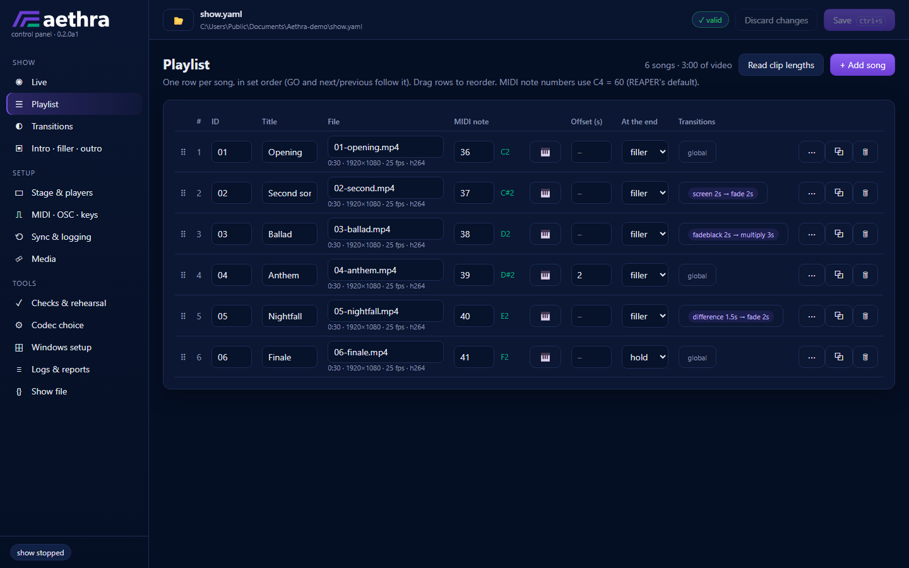
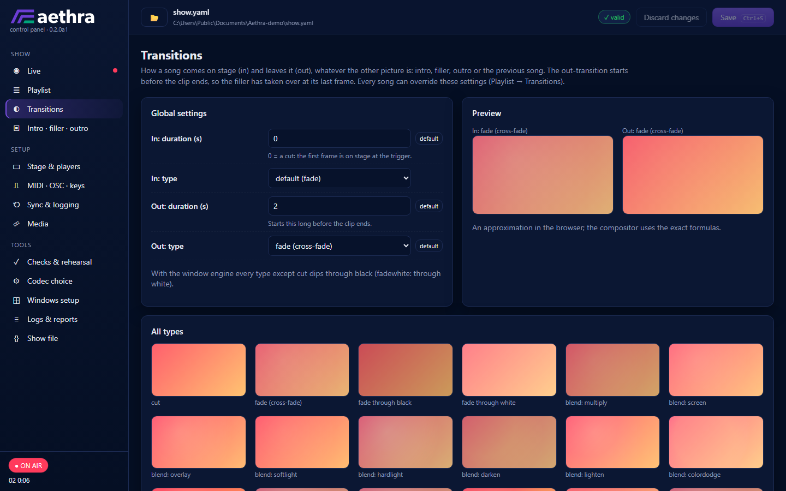
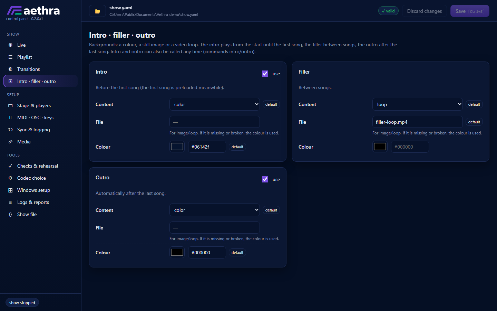
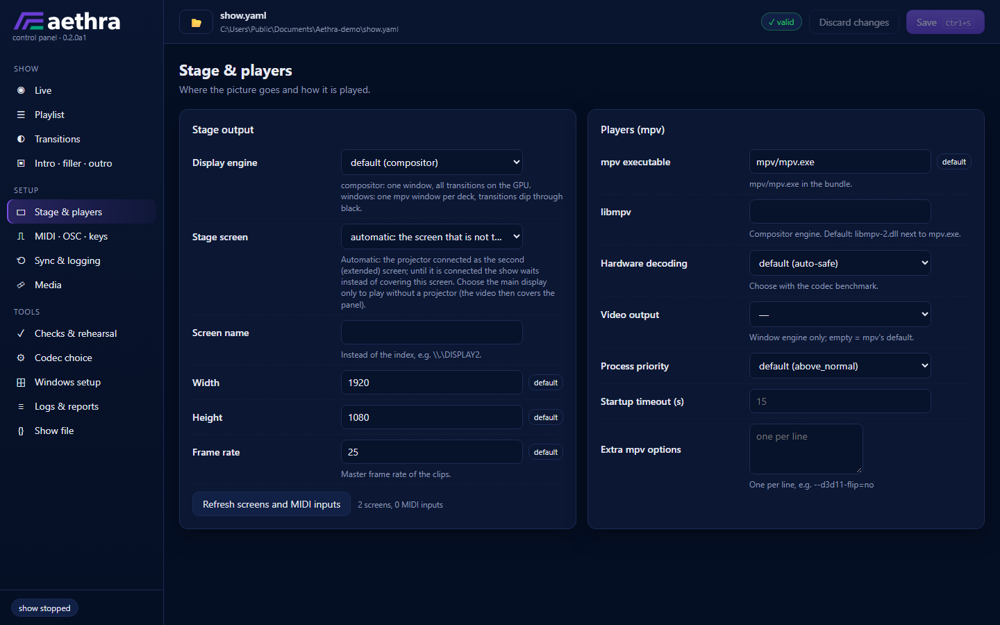
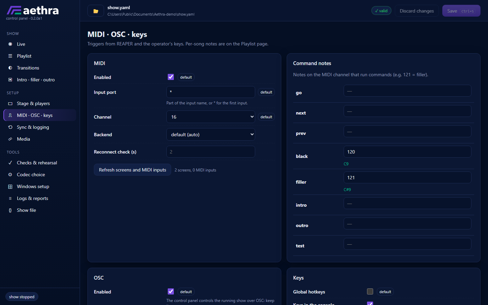
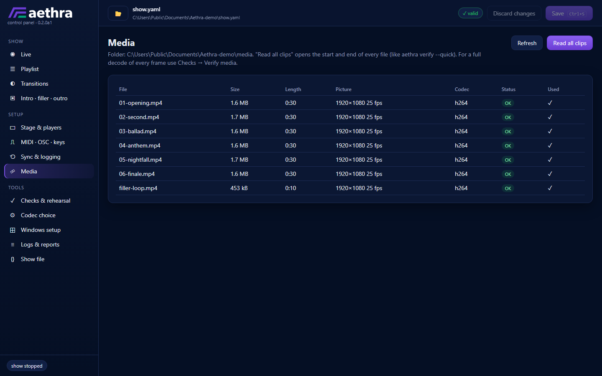
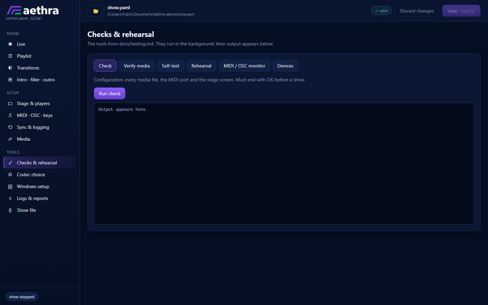
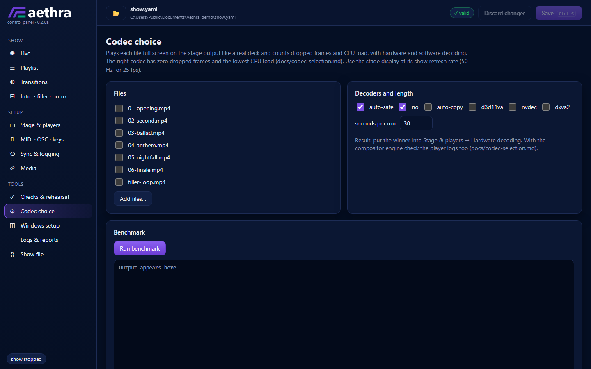
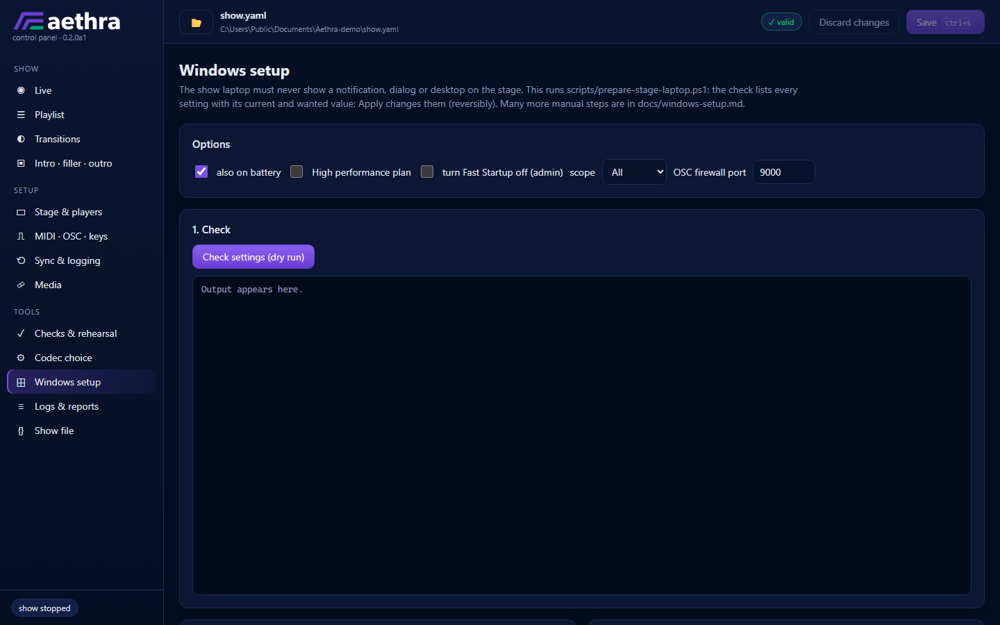
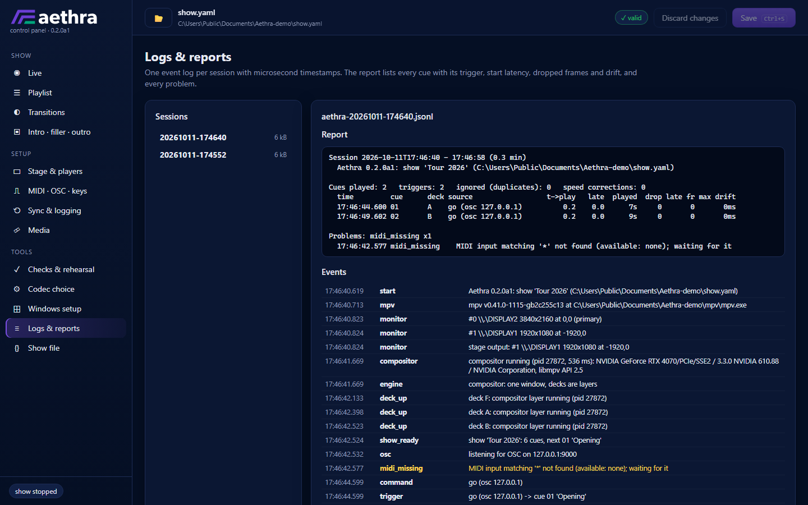

# Control panel

`Aethra panel` on the desktop (or `.\Aethra.cmd gui`) opens the control panel:
a window for everything around the show — editing the show file, the checks and
measurements from [testing.md](testing.md), the codec choice, the Windows
preparation, starting and watching the show, and the logs after it.

It is a local web page in its own Microsoft Edge window (app mode, no address
bar). A small server inside Aethra serves it on `127.0.0.1` only; every request
carries a random per-session token, so no other page or computer can use it.
Nothing is loaded from the internet. Without Edge it opens in the default
browser; `aethra gui --no-window` only prints the address.

## Pages

The screenshots show a demo show (six songs, generated test clips) on a
Windows computer with the projector as the second screen.

### Live

The page the panel opens with. Start and stop the show; what is on stage (the
song, its position and remaining time, the drift against the trigger clock,
the state of the three players); the next cue and the inputs; GO, previous,
next, blackout, filler, intro, outro and the test overlay; the set list (click:
select the next cue, double-click: start it now); the event log of the running
session.

### Playlist

One row per song in set order: id, title, clip (with length, picture size,
frame rate and codec once the clips have been read), MIDI note with its name
and a *learn* button (play the note), offset, what happens at the end, and the
song's transitions (click to override the global ones). `⋯` holds the OSC
trigger, program change and MTC start. Drag rows to reorder; clips in the media
folder that are not in the playlist can be added with one click.

### Transitions

The global in- and out-transitions and a preview of every type and blend mode
(animated; still while the show runs).

### Intro · filler · outro

The three backgrounds: a colour, a still image or a video loop each; intro and
outro are optional.

### Stage & players

The stage screen (automatic: the projector as the extended screen), the
picture size and frame rate, the display engine, mpv and hardware decoding.

### MIDI · OSC · keys

The MIDI input (with the inputs that are connected), command notes, OSC, and
the keys of every command.

### Sync & logging

Latency compensation, drift correction, MTC, logging and the test overlay (the
same layout as the pages above).

### Media

The clips in the media folder: length, picture, codec, and whether they fit the
stage (frame rate or size that differs is flagged); which ones the show uses.

### Checks & rehearsal

`check`, `verify`, the self-test, the rehearsal of the whole set, the MIDI/OSC
monitor and the device list; their output appears live below the buttons.

### Codec choice

The codec benchmark on chosen files and decoders, and the test clips for it.

### Windows setup

Checks the Windows settings of the show laptop (a dry run that lists every
setting with its current and wanted value), applies them reversibly, runs the
administrator items, reverts; creates the shortcuts and the autostart.

### Logs & reports

Every session: the report after the show (each cue with its trigger, start
latency, dropped frames and drift, and every problem) and all events. The
newest session opens first.

### Show file

The show file as it is on disk; open another one.

## The panel and the show on one laptop

The intended set-up: the projector is the laptop's **second, extended
screen** (`Win+P` > *Extend*, the laptop panel is the main display — see
[windows-setup.md](windows-setup.md), section 1), the show plays on the
projector, and the panel stays on the laptop's own screen, where it can be used
during the show.

* **Which screen gets the video.** With `stage.screen` left automatic it is the
  screen that is not the main display. If the projector is not connected (or
  not detected) when the show starts, the show **waits for it** — the Live page
  says so — instead of covering the laptop screen; *Stop* ends the waiting.
  When the projector is unplugged and plugged in again, the video goes back to
  the screen that is not the main display, whatever number Windows gives it.
  Only an explicit choice of the main display plays the video there (rehearsing
  without a projector).
* **Typing in the panel is safe.** The show's keys (Space = GO, arrows, `B`,
  `F`, `Esc` …) are global hotkeys: in any other program they run the show
  command instead of typing. While the panel has the focus, the keys that type
  (without Ctrl, Alt or Win) are released for it: typing in a field never
  touches the show, and outside the fields the panel itself runs the same keys
  (Space = GO). Keys with Ctrl/Alt (test overlay, quit) stay global. If the
  panel closes or hangs, the keys are global again after 2.5 s.
* **Nothing from the panel lands on the stage.** The stage windows never take
  the focus and hide the mouse pointer, so a pointer that wanders onto the
  projector is not seen. Tools that would put test pictures on the stage
  screen (codec benchmark, self-test on the stage screen) refuse to run during
  the show; tools that load the processor (full verify, test clips, reading
  all clips) ask first. The transition previews stand still during the show.
* The show's console window starts minimised when the panel starts the show
  (the panel keeps the focus; the console shows the same status).
* The show runs at a higher priority than the panel and the browser window, so
  the panel cannot slow it down.

## Good to know

* Changes are checked as you type (the badge at the top) and written with
  **Save** (`Ctrl+S`). A file with problems is only saved on request. The
  panel writes a tidy version of the file: comments are not kept, the
  previous version stays as `show.yaml.bak`.
* The show reads the file when it starts: save first, then start.
* The show runs in its usual console window with the usual restart loop; the
  panel only watches it (through a status file the show writes every second)
  and controls it **over OSC on 127.0.0.1** — keep `osc.enabled: true`. Closing
  the panel does not affect the show. Stopping from the panel is the same as
  pressing the quit key twice.
* MIDI *learn* and the MIDI monitor need the MIDI input, which the running show
  holds: stop the show first.
